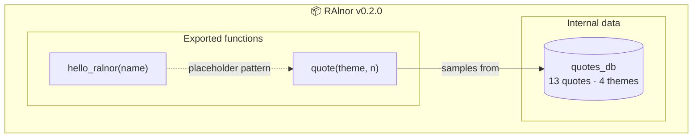

# RAlnor

An R package.

## Installation

You can install the development version from GitHub with:

```r
# install.packages("remotes")
remotes::install_github("MikkelAlnor/Ralnor")
```

## Example

```r
library(RAlnor)
hello_ralnor("world")
#> [1] "Hello, world!"

quote()
#> [1] "Fall seven times, stand up eight. - Japanese proverb"

quote(theme = "learning", n = 2)
```

Themes: `"perseverance"`, `"learning"`, `"courage"`, `"action"`

## Package Structure



### Function reference

| Function | Signature | Description | Returns |
| :--- | :--- | :--- | :--- |
| `hello_ralnor()` | `hello_ralnor(name = "world")` | Example greeting, demonstrating the roxygen2 + export pattern | `character(1)` greeting |
| `quote()` | `quote(theme = NULL, n = 1)` | Random inspirational quote(s), optionally filtered by theme: `"perseverance"`, `"learning"`, `"courage"`, `"action"` | `character(n)` quote(s) |

## Contributors

Thanks to everyone who has contributed to RAlnor:

| Contributor | Role | Contributions |
| :--- | :--- | :--- |
| [](https://github.com/MikkelAlnor) | Maintainer | 💻 Code · 📖 Docs · 🔧 Maintenance |
|  | AI Assistant ([Z.ai](https://z.ai)) | 💻 Code (roxygen docs, `quote()` theme system) |

*Badge legend: 💻 code · 📖 documentation · 🔧 maintenance · 🤖 AI-generated*

## Development

See `WORKFLOW.md` for the devtools-based development workflow, or run
`./install.sh` to install dependencies and the package from a source checkout.
